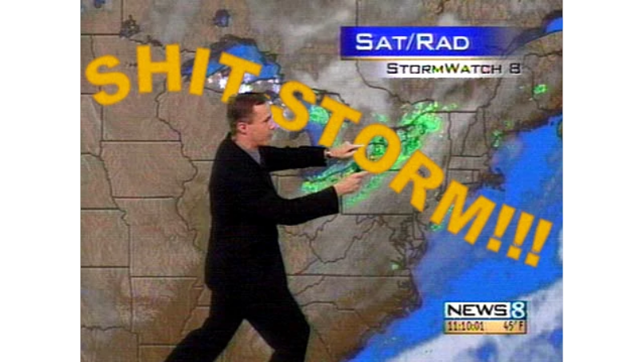

Naszym programistycznym światkiem wstrząsnął ten oto wpis: http://natemat.pl/105597,it-arystokracja. Artykuł jak artykuł, nieco grafomański, nieco tendencyjny, ale w gruncie rzeczy nic wielkiego. Klasyczny przedstawiciel domorosłego blogowego "dziennikarstwa". Gdy sam na niego trafiłem to zapomniałem o nim gdzieś pomiędzy jednym, a drugim mrugnięciem okiem. Wydawało mi się, że to nic nowego, rzeczy ogólnie znane, ale wszedłem na "fejsa", a tam gorączka. Wpisy u znajomych, nawet na [Grupie .NET szaleństwo](https://www.facebook.com/groups/net.developers.poland/permalink/293254287522600/). Truizm "uderz w stół, a nożyczki się odezwą" stał się ciałem. O tempora, o mores!

Kto by przypuszczał, że taki wpis wzbudzi tyle emocji… Aż sam się zagotowałem (tak, Johann to sem ja). Ale to co wzbudziło we mnie tyle emocji to niechęć do zwykłego powiedzenia "no okej, mam lepiej niż inni i co Ci do tego?". Czytając wpisy, rozmawiając ze znajomymi dowiedziałem się, że na zachodzie to Panie eurasy kokosy, a u nas co, ziemniaki mają być? Jak nie będę pracował za dziesięć tysi to co? Mam za miskę ryżu pracować? A w ogóle to po co ta dyskusja, prawa rynku, podaż, popyt. Panowie w prążki mający pieniążki na mnie zarabiają to ja mam nic nie przytulić? Frajer przeca nie jestem! Zgłupiałeś tak jak Ci co wybrali inne studia niż programistyczne? Życie to w ogóle brutalna dżungla, nie chcesz to jedź jak prezes Optimusa w Bieszczady i hoduj owce. No i ogólnie ten tego…

No dobra troszeczkę wyolbrzymiam, ale tak jak pisałem na fejsowej gównoburzy – nie rozumiem obruszenia, że ktoś nazwał naszą grupę uprzywilejowaną, bo przecież tacy jesteśmy. Popyt nas takimi uczynił, nie my sami.

Trochę dziecinne jest wg mnie udawać, że jest inaczej i się obrażać na takie stwierdzenia. Dodatkowo nie rozumiem takiego podejścia, że mnie
się udało, inni mogli robić to co ja to też by tak mieli. Chodzi mi tylko o odrobinę więcej pokory i szacunku dla innych. 

Tego sobie i innym życzę. 😉