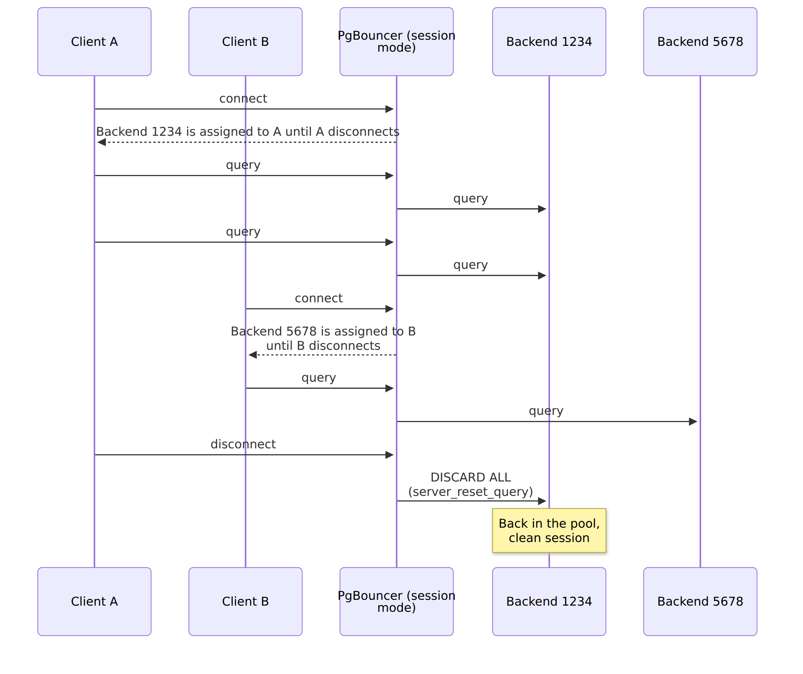
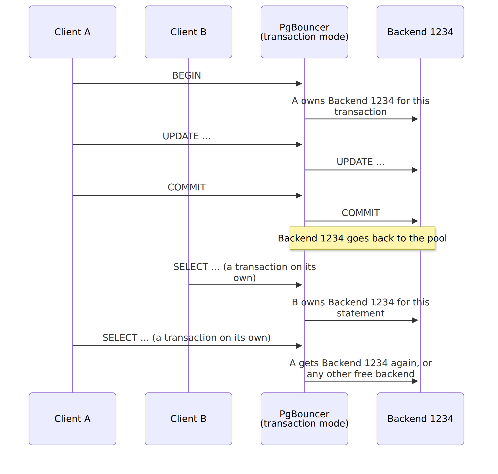
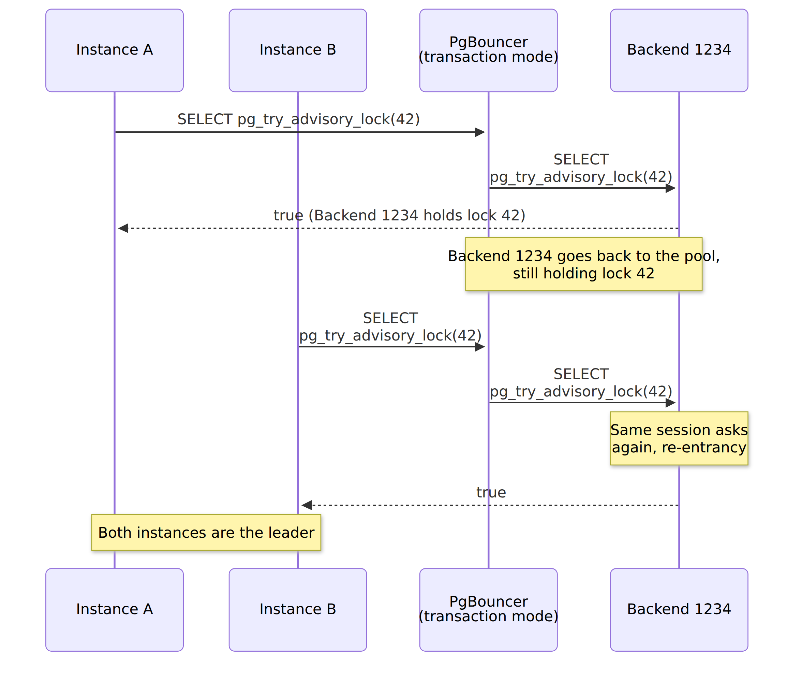
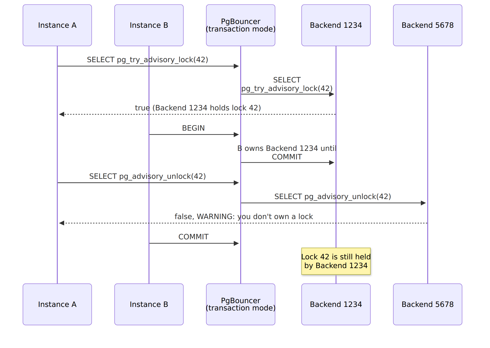
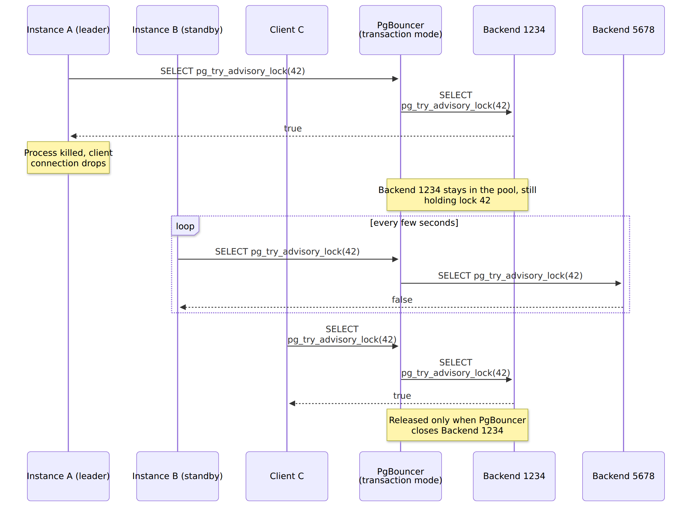

The sad thing about programming is that eventually we reach production; the closer we get, the nastier things get. Some people start asking, [Will it scale?](), and some even run performance and load tests. Then outcomes can bring all hands on deck.

I've been there, done that, and one common struggle I saw was connection management. It all starts with putting high, concurrent traffic on our services; then our database starts to run out of connections. Typically, each instance of your service has its own connection pool. Each pool keeps its connections open so it can reuse them for upcoming queries. But if you set it up wrong, multiplying your service instances can exhaust database connections just by keeping them open. Typically that's not an issue, as if they're not used, they will be killed, but in high-concurrency traffic? Gulp.

**A common way to deal with that is to put an external pooler like [PgBouncer](https://www.pgbouncer.org/) in front of the database.** Instead of each application pool holding its own set of connections to PostgreSQL, the applications connect to PgBouncer, and PgBouncer shares the same set of connections between them.

**When you configure PgBouncer, you need to choose a [pooling mode.](https://www.pgbouncer.org/features.html)** This choice clearly affects how connection sharing works and, in turn, performance. It also affects which database features will work. In PgBouncer, you'll usually choose between _session_ and _transaction_ mode. Transaction mode lets many more clients share the same database connections, but it's also the one that supports fewer features.

In this article, we'll cover what pooler modes are, why they exist, what you gain and lose with each, and what you need to watch out for. To show the differences, we'll use PostgreSQL advisory locks. Yes, I know, you might not have used them in your code. They're not the most commonly used feature, so we'll start with the basics. I chose them because they come in two flavours: one scoped to a session and one scoped to a transaction. Pooler modes are also about sessions and transactions, so advisory locks clearly show the differences between modes. Plus, they're used in tools you use, and you may not be aware of that, which can lead to nasty surprises.

We'll use PgBouncer as the main example, but we'll also discuss other connection pools, since you may face the same scenarios with poolers like AWS RDS Proxy.

## Why connection poolers have modes

I wrote about the basics in [Mastering Database Connection Pooling](/en/architecture-weekly-189-mastering/), so here's a quick recap.

PostgreSQL starts a separate process for each connection, called a backend. Starting each one costs resources; each takes memory, and the number is limited by the `max_connections` setting. That's why we use connection pools. A pool in our application keeps a few connections open and reuses them. That helps, but only within a single process. If you run twenty instances of a service, each with a pool of twenty connections, PostgreSQL has to keep four hundred backends, most of them just sitting there and waiting. Serverless makes it even worse, as each function invocation may want its own connection (read more in [my other article](/en/talk-is-cheap-show-me-the-numbers/)).

That's where tools like [PgBouncer](https://www.pgbouncer.org/) come in. Applications connect to PgBouncer as if it were PostgreSQL, and PgBouncer keeps a much smaller set of real connections to the database. I'll call the connection between the application and PgBouncer a _client connection_, and the one between PgBouncer and PostgreSQL a _server connection_. Each server connection is one backend.

PgBouncer decides when a server connection used by one client can be given to another. This matters because PostgreSQL keeps state on the connection. When you change a setting with _SET_, create a temporary table, prepare a statement, subscribe with _LISTEN_, or use advisory lock, all of that is stored in the backend process until you disconnect. PostgreSQL calls it a session. If PgBouncer gives your backend to someone else, they also get your session with everything you left in it.

The [PgBouncer documentation](https://www.pgbouncer.org/config.html) describes the _pool_mode_ setting as the one that "specifies when a server connection can be reused by other clients". It has three options: session, transaction, and statement.

**In session mode, a client gets a server connection for as long as it stays connected.** When the client disconnects, PgBouncer cleans the server connection up and puts it back into the pool so that another client can take it. Cleaning up means running _server_reset_query_, which by default is _DISCARD ALL_. It wipes everything the previous client left in the session.



From the application's perspective, it's almost the same as connecting directly to PostgreSQL. All features work, and you don't need to change anything in your code. Now, your application and PgBouncer become friends with benefits. PgBouncer caps the number of server connections, so during a traffic spike, clients wait for a free one instead of exhausting _max_connections_ (which can, of course, end in a timeout). It also reuses server connections, so an application that opens and closes connections often (hello, serverless!) doesn't start a new backend each time. Don't assume that makes connecting faster, though; the benchmark below shows it depends on your setup.

Still, as long as a client keeps its connection open, the server connection stays reserved for it, even if the client does nothing. Application pools keep connections open longer, since that's their job: safely reusing them. In session mode, as you reserve connections, you still need roughly as many server connections as all your application pools together. That doesn't help much with our initial problem.

**In transaction mode, a client gets a server connection only for the duration of a transaction.** When the transaction ends, PgBouncer takes the server connection back and can give it to another client. Remember that in PostgreSQL, each statement run outside of an explicit _BEGIN_ is an automatic transaction on its own. So two statements from the same client can run on two different backends, and statements from two different clients can run on the same backend, one after another. SQLite is different, which is why [it's recommended to open them explicitly right away](https://berthub.eu/articles/posts/a-brief-post-on-sqlite3-database-locked-despite-timeout/).



The transaction was chosen as the unit for a reason. A typical request handler opens a transaction, runs a few queries, commits, and then doesn't touch the connection until the next request. Transaction mode uses that idle time. A client blocks a server connection only while it's in a transaction, and the rest of the time, other clients can use it.

That's why transaction mode is usually described as faster. Individual queries don't run faster, but the same number of backends can serve many more clients. When a client doesn't have a transaction open, other clients can use its server connection, together with the session that lives on it.

It's like a multilane motorway: it gets higher total throughput because you're not limited to one path and going as the slowest car in front of you. Yet, that doesn't mean that you can't get slow or stuck on the motorway. That can happen there too, but less likely.

I checked that with a simple test. I configured PgBouncer to allow 10 server connections. A hundred clients try to connect through PgBouncer and run a short query and keep their connection open, as an application pool would. In session mode, ten clients got their results, and the other ninety were stuck waiting, because all server connections belonged to the first ten. In transaction mode, all hundred got their results, and PgBouncer didn't even need all ten server connections. In my runs, it opened three or four.

The test reads those numbers from PgBouncer itself. PgBouncer has an admin console: a special database called pgbouncer, where instead of regular SQL, you run commands that show PgBouncer's internal state. See [my Docker Compose setup](https://github.com/oskardudycz/event-driven.io/tree/main/content/posts/2026-10-12--connection-pooler-modes-advisory-locks/code/docker-compose.yml)

```bash
psql -h localhost -p 6432 -U pgbouncer_admin pgbouncer
```

and run:

```sql
SHOW POOLS;
```

You'll see something like this (I removed the columns and rows we don't need):

```
 database |   user   | cl_active | cl_waiting | sv_active | sv_idle
----------+----------+-----------+------------+-----------+---------
 app      | app_user |        10 |         90 |        10 |       0
```

Ten clients are active, ninety are waiting, and all ten server connections are taken. In the transaction mode PgBouncer (port 6433), the pool with ten server connections is called _app_multiplex_; I'll explain such aliases in a moment. The same test ends there with:

```
   database    |   user   | cl_active | cl_waiting | sv_active | sv_idle
---------------+----------+-----------+------------+-----------+---------
 app_multiplex | app_user |       100 |          0 |         0 |       4
```

All hundred clients are connected, nobody is waiting, and the four server connections that PgBouncer opened are idle, ready for whoever needs them next.

I also ran [pgbench](https://www.postgresql.org/docs/current/pgbench.html), PostgreSQL's benchmarking tool, against both modes: fifty clients, ten server connections, and thirty seconds of read-only queries. Here's what I got:

|                                            | Session mode     | Transaction mode      |
| ------------------------------------------ | ---------------- | --------------------- |
| Transactions per second                    | 20,884           | 22,040                |
| Clients that ran at least one transaction  | 50               | 50                    |
| Clients that ran more than one transaction | 10               | 50                    |
| Transactions per client                    | from 1 to 62,906 | from 13,147 to 13,206 |

Throughput was close, which makes sense, as in both modes, the same ten backends did all the work. In my earlier runs, session mode sometimes came out ahead, so I wouldn't read much into the difference. What differed is who got served. In session mode, ten clients ran all the queries, and the other forty waited for the whole run. Each of them ran a single transaction at the very end, once the first ten disconnected. In transaction mode, all fifty clients got a fair share.

So transaction mode didn't make my database faster; it let all clients use it. If someone tells you that transaction mode made their benchmark faster, check what they measured.

I also checked the cost of connecting. With the _-C_ option, pgbench opens a new connection for each transaction. Connecting directly to PostgreSQL, ten clients ran 617 transactions per second. Through PgBouncer, they ran 377 in session mode and 429 in transaction mode. So in my setup, PgBouncer made reconnecting slower, not faster. I suspect authentication. PostgreSQL 18 uses SCRAM by default, so I configured PgBouncer the same way, and PgBouncer, which runs on a single thread, has to authenticate every new client itself. In a quick one-off check with authentication turned off on both sides, PgBouncer was clearly faster than direct connections. I didn't dig deeper, so treat it as a hint, not a diagnosis.

Treat all those numbers with a grain of salt. They come from my small box (AMD Ryzen 5 5500U, 12 cores, 30 GB of RAM) and Docker, not from a tuned production setup. You'll find the exact commands and full output [in the repository](https://github.com/oskardudycz/event-driven.io/blob/main/content/posts/2026-10-12--connection-pooler-modes-advisory-locks/code/bench/results.md).

**Transaction mode has its price, though.** Since the backend is shared, PgBouncer can't keep session state for you. Whatever you leave in a session stays there for the next client that gets the same backend, and you won't see it in your next transaction if it lands on a different backend. PgBouncer doesn't try to track that. Its [feature table](https://www.pgbouncer.org/features.html) lists what's not supported in transaction mode: _SET/RESET_, _LISTEN_, _WITH HOLD_ cursors, SQL-level _PREPARE_, and session-level advisory locks are all marked as "Never".

**The danger part is that PgBouncer won't stop you from using those features, though. ** For the advisory locks and _SET_ I'll show below, you won't get any error!** PgBouncer passes your SQL to PostgreSQL, PostgreSQL does what you asked for, and nobody tells you that the result now sits in a backend shared with other clients. We'll see what that means in a moment.

**Statement mode** goes even further and takes the server connection back after each statement, so multi-statement transactions are not allowed. I won't spend time on it, since everything I'll write about transaction mode applies here as well.

Before we get to advisory locks, one more thing: **the mode doesn't have to be the same for everything.** The simplest setup sets it globally in _pgbouncer.ini_:

```ini
[databases]
app = host=postgres port=5432 dbname=app

[pgbouncer]
listen_addr = 0.0.0.0
listen_port = 6432
auth_type = scram-sha-256
auth_file = /etc/pgbouncer/userlist.txt
admin_users = pgbouncer_admin
pool_mode = session
default_pool_size = 10
```

Switching everything to transaction mode means changing a single line:

```ini
pool_mode = transaction
```

You can also set the mode per database entry. An entry in the _[databases]_ section is an alias so that you can have several aliases pointing to the same PostgreSQL database, each with its own settings:

```ini
[databases]
app            = host=postgres port=5432 dbname=app pool_size=1
app_processors = host=postgres port=5432 dbname=app pool_mode=session
```

Clients connecting to _app_ get the global transaction mode, and clients connecting to _app_processors_ get session mode, even though both connect to the same database. You can do the same per user:

```ini
[users]
processor = pool_mode=session
```

Now all connections made by the _processor_ user get session mode, whichever alias they use. According to [the documentation](https://www.pgbouncer.org/config.html), PgBouncer uses the user's mode first, then the database's, and then the global one.

So if you use tools that rely on session-level advisory locks (e.g. for leader election), switching to transaction mode globally will break them. Still, that's not as drastic as it sounds. You can keep transaction mode for most of the traffic and use session mode, through a dedicated alias or user, only for the connections that need it, like background processors.

Let's see why it would break them.

## What advisory locks show about each mode

Let's take a typical example. You run a few instances of your service. Each of them has a background processor that reads events and updates a read model, for example, a shopping cart summary.

If two instances process the same events at the same time, they can overwrite each other's updates, count the same item twice, or apply events out of order. So we need to ensure only one instance runs a specific processor at a time. In Kubernetes-like setups, we don't fully control how many instances are running, so we need something they all share to coordinate. The database is a natural candidate, as all instances already use it.

Tools like [Emmett](https://github.com/event-driven-io/emmett), Marten and Wolverine handle that for you, and under the hood, they use PostgreSQL advisory locks. I wrote more about that in [Rebuilding Event-Driven Read Models in a safe and resilient way](/en/rebuilding_event_driven_read_models/) and [Distributed Locking: A Practical Guide](/en/distributed-locking-a-practical-guide/).

Jeremy D. Miller described the simplest way to do it in [Using PostgreSQL Advisory Locks for Leader Election](https://jeremydmiller.com/2020/05/05/using-postgresql-advisory-locks-for-leader-election/). Each instance keeps trying to grab the same advisory lock. If it gets it, it becomes the leader and starts processing. If the lock is already taken, another instance is processing, so it tries again later. If the leader dies, its connection drops, PostgreSQL releases the lock, and another instance takes over. In Jeremy's words: _"If the current async daemon node fails, the connection will drop and the global advisory lock is released and ready for another node to take over."_

[Advisory locks](https://www.postgresql.org/docs/current/explicit-locking.html#ADVISORY-LOCKS) are locks on numbers. PostgreSQL doesn't care what the number means; it only tracks who holds it. Tools usually hash some name into a 64-bit number. In Emmett, I'm hashing the processor id (I showed the md5-based formula in [the article on rebuilding read models](/en/rebuilding_event_driven_read_models/)). Each instance calculates the same number for the same processor, so they all compete for the same lock. In the examples below, the number 42 represents our shopping cart summary processor.

Advisory locks come in two flavours:

- **session-level**, for example, _pg_try_advisory_lock_, held until you release them or the session ends,
- **transaction-level**, for example, _pg_try_advisory_xact_lock_, released automatically when the transaction ends. You can't release them earlier.

Session mode gives you a session, and transaction mode gives you a transaction. Let's see what happens when those meet.

If you'd like to follow along, I prepared [a Docker Compose setup](https://github.com/oskardudycz/event-driven.io/tree/main/content/posts/2026-10-12--connection-pooler-modes-advisory-locks/code) with PostgreSQL and PgBouncer in both modes, together with tests that run every query from this article and check the results. All the outputs below come from it.

We'll start without any pooler. Open two terminals and connect both directly to PostgreSQL (the password is _app_password_):

```bash
psql -h localhost -p 5432 -U app_user app
```

In the first terminal (let's call it instance A), take the lock:

```sql
SELECT pg_try_advisory_lock(42) AS locked;
```

```
 locked
--------
 t
(1 row)
```

Run the same query in the second terminal (instance B):

```
 locked
--------
 f
(1 row)
```

Instance A holds the lock, so B didn't get it. Now close the first terminal (_\q_) and run the query in the second one again:

```
 locked
--------
 t
(1 row)
```

When A's session ended, PostgreSQL released its lock, and B took over. That's the failover Jeremy described.

Now let's try something else in a single terminal and take the same lock twice:

```sql
SELECT pg_try_advisory_lock(42) AS locked;
SELECT pg_try_advisory_lock(42) AS locked;
```

```
 locked
--------
 t
(1 row)

 locked
--------
 t
(1 row)
```

Both returned _true_. Session-level locks are re-entrant: if the session that already holds the lock asks for it again, it gets it again. It also needs to release it as many times as it took it:

```sql
SELECT pg_advisory_unlock(42) AS unlocked;
SELECT pg_advisory_unlock(42) AS unlocked;
SELECT pg_advisory_unlock(42) AS unlocked;
```

```
 unlocked
----------
 t
(1 row)

 unlocked
----------
 t
(1 row)

WARNING:  you don't own a lock of type ExclusiveLock
 unlocked
----------
 f
(1 row)
```

The third call had nothing left to release, so it returned _false_ with a warning. Within a single session, that's reasonable behaviour. Remember it, though, as it'll bite us soon.

Transaction-level locks behave differently. In instance A, start a transaction and take the lock:

```sql
BEGIN;
SELECT pg_try_advisory_xact_lock(42) AS locked;
```

```
BEGIN
 locked
--------
 t
(1 row)
```

If instance B now tries to take the same lock with _pg_try_advisory_lock(42)_, it gets _false_. Once A runs _COMMIT_ (or _ROLLBACK_), the lock is released, and B gets _true_.

Two more things are worth knowing. Locks can be shared or exclusive. Many sessions can hold the same shared lock (_pg_try_advisory_lock_shared_), but nobody can take the exclusive one until all shared ones are released. You can also either try or wait. The _pg_try_ functions return _false_ immediately if the lock is taken, while _pg_advisory_lock_ waits until it's released. Leader election usually uses the _try_ version in a loop, so the standby instance doesn't hang on a blocked query.

You can check who holds which lock in the _pg_locks_ view. Run it while instance A holds the lock (I replaced the real process id in the output with 1234; you'll see a different one):

```sql
SELECT pid, classid, objid, objsubid, mode, granted
FROM pg_locks
WHERE locktype = 'advisory';
```

```
 pid  | classid | objid | objsubid |     mode      | granted
------+---------+-------+----------+---------------+---------
 1234 |       0 |    42 |        1 | ExclusiveLock | t
(1 row)
```

PostgreSQL splits a 64-bit key into two 32-bit halves, stored in _classid_ and _objid_, and _objsubid_ equal to 1 tells us it was a single 64-bit key. The most interesting column for us is _pid_. It's the id of the backend process that holds the lock. When you connect directly to PostgreSQL, one connection means one backend, so they're the same thing. Through a pooler, they're not.

**Let's now put PgBouncer in between, in session mode.** Connect both terminals to the session mode PgBouncer:

```bash
psql -h localhost -p 6432 -U app_user app
```

From now on, I'll also ask PostgreSQL which backend ran the query, using _pg_backend_pid()_. As before, I replaced the real process ids with 1234 and 5678, so they're easier to follow. You'll see different numbers, but where I show the same number twice, you'll get the same one twice:

```sql
SELECT pg_try_advisory_lock(42) AS locked, pg_backend_pid() AS pid;
```

Instance A gets the lock:

```
 locked | pid
--------+------
 t      | 1234
(1 row)
```

Instance B doesn't, and it runs on a different backend:

```
 locked | pid
--------+------
 f      | 5678
(1 row)
```

After A disconnects, B gets the lock:

```
 locked | pid
--------+------
 t      | 5678
(1 row)
```

That's the same behaviour as without PgBouncer, with one subtle difference. When A disconnected, its backend (1234) didn't end. PgBouncer kept the server connection and put it back into the pool. The lock was released only because PgBouncer ran _DISCARD ALL_ before giving that backend to someone else, and _DISCARD ALL_ also releases advisory locks.

**Now let's switch to transaction mode.** For the demo, I configured the _app_ alias with a pool of a single server connection. That makes the results deterministic, as every client is guaranteed to get the same backend. With a bigger pool, the same happens, just not on every query. We'll get back to that.

Connect both terminals to the transaction mode PgBouncer:

```bash
psql -h localhost -p 6433 -U app_user app
```

Instance A takes the lock:

```sql
SELECT pg_try_advisory_lock(42) AS locked, pg_backend_pid() AS pid;
```

```
 locked | pid
--------+------
 t      | 1234
(1 row)
```

Instance B runs the same query:

```
 locked | pid
--------+------
 t      | 1234
(1 row)
```

**Both got _true_, so both believe they're the leader, and both start updating our shopping cart summary. Possibly overriding each other.**

Check the _pid_ column. A's statement was a transaction on its own, so once it finished, PgBouncer took the backend back. B's statement got the same backend. For PostgreSQL, that's the same session asking for a lock it already holds. Re-entrancy kicks in, and it returns _true_, without any error or warning.

PostgreSQL still holds the lock, and it assigns it to backend 1234. PgBouncer shares that backend between unrelated clients, so whoever lands on it effectively owns the lock.



**Releasing the lock has the same issue.** Let's say instance A finished its work and wants to give up leadership. To show that, I need two server connections in the pool. In the demo, that's the _app_pair_ alias, so connect with _psql -h localhost -p 6433 -U app_user app_pair_. Instance A takes the lock as before:

```sql
SELECT pg_try_advisory_lock(42) AS locked, pg_backend_pid() AS pid;
```

```
 locked | pid
--------+------
 t      | 1234
(1 row)
```

At the same moment, instance B is in the middle of a longer transaction:

```sql
BEGIN;
SELECT pg_backend_pid() AS pid;
```

```
BEGIN
 pid
------
 1234
(1 row)
```

B's transaction took backend 1234. Now instance A releases the lock:

```sql
SELECT pg_advisory_unlock(42) AS unlocked, pg_backend_pid() AS pid;
```

```
WARNING:  you don't own a lock of type ExclusiveLock
 unlocked | pid
----------+------
 f        | 5678
(1 row)
```

Backend 1234 was busy with B's transaction, so PgBouncer sent A's unlock to the other one, 5678. That backend doesn't hold the lock, so PostgreSQL returned _false_ with a warning. After B commits, the _pg_locks_ query from before shows:

```
 pid  | classid | objid | objsubid |     mode      | granted
------+---------+-------+----------+---------------+---------
 1234 |       0 |    42 |        1 | ExclusiveLock | t
(1 row)
```

Instance A thinks it released the lock, but backend 1234 still holds it, and no other instance can take it, unless it lands on backend 1234. Database drivers don't treat warnings as errors. For instance, node-postgres reports them as _notice_ events, which you won't see unless you subscribe to them. So in a real application, you most likely wouldn't notice it.



**Now let's check the case leader election was built for: the leader dies.** Instance A takes the lock through the _app_ alias:

```sql
SELECT pg_try_advisory_lock(42) AS locked, pg_backend_pid() AS pid;
```

```
 locked | pid
--------+------
 t      | 1234
(1 row)
```

Then we kill its process. Instance B is on standby and keeps trying to take over. In the demo, it connects through the _app_other_ alias, a separate pool that's guaranteed to use a different backend, which can easily happen on a busy system. It runs the same query and gets:

```
 locked | pid
--------+------
 f      | 5678
(1 row)
```

It gets the same result again and again. Meanwhile, any other client that runs the same query through the _app_ alias gets:

```
 locked | pid
--------+------
 t      | 1234
(1 row)
```

Failover relies on the connection being dropped when the leader dies. In our case, the dropped connection was the client connection to PgBouncer. The server connection to PostgreSQL is still alive in PgBouncer's pool, and in transaction mode, no reset query runs on it. The docs say it explicitly: _"When transaction pooling is used, the server_reset_query is not used"_. So the instance that should take over can't, and whichever instance lands on backend 1234 can become the leader instead.



The lock stays until PgBouncer closes that server connection. [By default](https://www.pgbouncer.org/config.html), it closes server connections that were idle for ten minutes (_server_idle_timeout_) or are older than an hour and not used by any client at the moment (_server_lifetime_). On a busy system, a backend is rarely idle for ten minutes, so going by those defaults, the lock can stay there for up to an hour. Pardon me, but I didn't wait an hour to check it, though.

**Transaction-level locks work fine in transaction mode.** Their lifetime is the transaction, and in transaction mode, you own the backend for exactly that long. Instance A starts a transaction and takes the lock:

```sql
BEGIN;
SELECT pg_try_advisory_xact_lock(42) AS locked, pg_backend_pid() AS pid;
```

```
BEGIN
 locked | pid
--------+------
 t      | 1234
(1 row)
```

While A's transaction is open, instance B, connected through _app_other_, tries the same:

```sql
SELECT pg_try_advisory_xact_lock(42) AS locked, pg_backend_pid() AS pid;
```

```
 locked | pid
--------+------
 f      | 5678
(1 row)
```

After A runs _COMMIT_, PostgreSQL releases the lock, and only then does PgBouncer give the backend to someone else. When B runs the query again, it gets _true_. Nothing leaks. If you need to ensure that only one instance does a specific piece of work at a time, like the shared and exclusive locks around inline projections from my [rebuild article](/en/rebuilding_event_driven_read_models/), that works fine through transaction mode.

There's a catch, though. A transaction-level lock taken outside of an explicit transaction protects nothing. Instance A runs:

```sql
SELECT pg_try_advisory_xact_lock(42) AS locked, pg_backend_pid() AS pid;
```

```
 locked | pid
--------+------
 t      | 1234
(1 row)
```

And instance B, right after:

```
 locked | pid
--------+------
 t      | 5678
(1 row)
```

A's statement was a transaction on its own, so it released the lock when it committed. You'd get the same result when connecting directly to PostgreSQL, so we can't blame the pooler this time. Still, it's an easy mistake to make. If you take a transaction-level lock at the start of processing and expect it to keep others away until you finish, it won't. We'll see a real example of that later.

**All those examples follow the same rule. Whatever you keep on the connection has to end before the pooler takes the connection back.** Session mode takes it back when you disconnect, so session-level locks work. Transaction mode takes it back after each transaction, so only transaction-level locks work there.

**Such issues are hard to diagnose.** In the demos I showed you, the failures happen every time because the pool has a single server connection. In production, pools are bigger. To check what happens then, I used a pool of twenty server connections and ten concurrent workers. Each worker made fifty attempts to become the leader for lock 42. When it succeeded, it pretended to work for five milliseconds and then released the lock. I counted how often a worker got the lock while another one still believed it was the leader.

I ran it ten times in each mode. In session mode, workers got the lock from 32 to 41 times per run, and two of them never held it at the same time. In transaction mode, workers got the lock from 74 to 111 times per run, and in 63 to 103 of those cases, another worker already believed it was the leader. Between 57 and 87 unlocks per run landed on a backend that didn't hold the lock.

That's a busy setup, with workers fighting for the lock all the time. Real leader election is calmer, so I also ran three workers that worked for 200 milliseconds and waited up to 200 milliseconds between attempts. The numbers went down, but not to zero: every one of the ten runs had overlaps, from 2 to 38.

The numbers differed a lot between runs, as they depend on which backend each statement happened to get, which depends on load and timing. 

**That's what makes such issues hard to reproduce: the code looks correct, the lock functions return what you'd expect from them, and the consequences show up later, somewhere else.**

Again, the worst thing is that you probably won't easily know this issue happened. PostgreSQL returned _true_ to a session that asked for a lock it already held, which is correct from its point of view. PgBouncer did what its documentation says. The failed unlock produced a warning that your application most likely never saw. _pg_locks_ shows which backend holds the lock, and PgBouncer's _SHOW SERVERS_ can tell you which client uses that backend right now, but not which one took the lock an hour ago. All you'll see are the consequences: a read model with doubled numbers, events applied out of order, an email sent twice. Debugging that is not a pleasant experience. To say mildly.

## Not only advisory locks

Advisory locks are not the only feature affected; all session state behaves the same way. Let's take a simple example. Through the transaction mode PgBouncer, instance A changes its statement timeout:

```sql
SET statement_timeout = '5s';
```

```
SET
```

Then instance B, which never changed anything, checks its own:

```sql
SHOW statement_timeout;
```

```
 statement_timeout
-------------------
 5s
(1 row)
```

B now runs with A's timeout. PgBouncer does [track some parameters](https://www.pgbouncer.org/config.html#track_extra_parameters): those that PostgreSQL reports back to the client, like _application_name_, _TimeZone_ and, since PgBouncer 1.26 and PostgreSQL 18, _search_path_. It remembers each client's values and restores them when the client gets a backend. I checked it: when instance A runs _SET search_path_, instance B still sees the default one. _statement_timeout_ isn't on that list, and neither are most other settings, so they leak as shown above.

PgBouncer's feature table also lists _LISTEN_ (you subscribe on one backend, and the notifications arrive there, not where your next query runs), temporary tables that should live longer than a transaction, and SQL-level _PREPARE_ as not supported in transaction mode. They keep their state in the session, just like the examples above. 

Prepared statements sent through the protocol, which is what most drivers use, are a different story. PgBouncer [can track them](https://www.pgbouncer.org/config.html#max_prepared_statements) in transaction mode since version 1.21, and since 1.24, it does so by default. That doesn't cover SQL-level _PREPARE_, _EXECUTE_ and _DEALLOCATE_, though.


### Connection Pools Duel of the Fates

There's one more issue to watch out for, not related to session state: **two pools can fight over timeouts.** If you put PgBouncer in front of the database but keep your application pools, you have two pools. Each of them decides on its own when a connection has been idle for too long. If PgBouncer's _client_idle_timeout_ is shorter than your application pool's idle timeout, PgBouncer closes a client connection that your application still considers open and ready to use.

I checked what happens with node-postgres, which [Dumbo](https://github.com/event-driven-io/Pongo/tree/main/src/packages/dumbo) uses under the hood (this behaviour is the same with other popular drivers in other environments like [Npgsql](https://www.npgsql.org/), etc.). Its pool keeps an idle connection for ten seconds by default, and I set PgBouncer's _client_idle_timeout_ to two seconds. There are two cases.

If the connection sits idle in the application pool, the pool notices that PgBouncer closed it, removes it, and the next query quietly gets a new connection. Still, the pool reports the closed connection by emitting an _error_ event. If nothing listens, Node.js treats it as an uncaught exception, and the process crashes.

If the application holds the connection, for example, a background processor that keeps one open between polls, its next query fails with:

```
Client has encountered a connection error and is not queryable
```

PgBouncer's documentation marks _client_idle_timeout_ as potentially dangerous and says that it "should be larger than the client-side connection lifetime settings, and only used for network problems".

## Beyond PgBouncer: ignore, pin, or reject

Other poolers face the same problem. Each pooler that shares backends between transactions needs to decide what to do when a client creates session state. There aren't many options.

**Ignore it.** That's what PgBouncer does in transaction mode. It's simple and fast, as the pooler doesn't need to understand the SQL you send. It documents what's not supported, and if you use it anyway, the state leaks, as we saw above.

**Detect it and pin the client to a backend.** That's what [AWS RDS Proxy](https://docs.aws.amazon.com/AmazonRDS/latest/UserGuide/rds-proxy-pinning.html) does. By default, it shares backends between transactions. Still, when it notices that a client changed session state, it pins that client: _"When a connection is pinned, each later transaction uses the same underlying database connection until the session ends. Other client connections also can't reuse that database connection until the session ends."_. For PostgreSQL, pinning is triggered by, among others, _SET_, _PREPARE_, temporary tables, _LISTEN_, and _"interacting with locks using functions such as pg_advisory_lock and pg_try_advisory_lock"_.

So, with the described leader-election style behind RDS Proxy, the session-level lock pins the client. According to the docs, later transactions go to the backend that holds the lock, so the lock shouldn't get a second owner. What happens when the leader dies is less clear to me. AWS says that _"the session ends when the client connection is dropped"_, but not whether the database connection is reset or closed then, and that's what would release the lock.

Pinning has its cost, though, as a pinned client is effectively in session mode. If most of your clients get pinned, you pay for a proxy that behaves like session pooling. AWS says that directly: _"If all or almost all of your connections experience pinning, consider modifying your application code or workload to reduce the conditions that cause the pinning."_ Also, if your application's pool runs _DISCARD ALL_ when it returns a connection, RDS Proxy pins that client too.

Transaction-level advisory locks don't cause pinning: "RDS Proxy does not pin on transaction level advisory locks, specifically pg_advisory_xact_lock, pg_advisory_xact_lock_shared, pg_try_advisory_xact_lock, and pg_try_advisory_xact_lock_shared." That makes sense for the same reason they work in PgBouncer's transaction mode: they end with the transaction, so there's nothing to pin. It also means that RDS Proxy won't save you from a transaction-level lock released right after you took it.

**Reject it.** A pooler could also refuse statements that create session state, or close the client connection when it sees one. Then you'd learn about the problem when you run your code for the first time, not in production.

If you're using a different pooler, check which of those it does for the features you rely on. Its documentation should tell you that, typically in the section about limitations or pinning.

And hey, I'm not writing this article like I'm a smartass. I'm writing it because I've hit those issues several times recently, for instance...

[Emmett](https://github.com/event-driven-io/emmett) makes sure that only one instance runs a specific processor, like our shopping cart summary projection. The idea was inspired by what Jeremy and I did in Marten. In Emmett, I added a status table on top of it, as I described in [the article on rebuilding read models](/en/rebuilding_event_driven_read_models/). Advisory locks are fast, but they vanish when a connection fails, so they can't be the only source of truth.

Here's a shortened version of the current processor lock ([full source](https://github.com/event-driven-io/emmett/blob/9d93421fca6b5e8c090b98e0900bff2d4b4ed7d8/src/packages/emmett-postgresql/src/eventStore/schema/processors/processorsLocks.ts)):

```sql
WITH lock_check AS (
    SELECT pg_try_advisory_xact_lock(p_lock_key) AS lock_acquired
),
ownership_check AS (
    INSERT INTO emt_processors (...)
    SELECT ...
    WHERE (SELECT lock_acquired FROM lock_check) = true
    ON CONFLICT (processor_id, partition, version) DO UPDATE
    SET processor_instance_id = p_processor_instance_id,
        status = 'running',
        last_updated = v_current_time
    WHERE emt_processors.processor_instance_id = p_processor_instance_id
       OR emt_processors.processor_instance_id = 'emt:unknown'
       OR emt_processors.status = 'stopped'
       OR emt_processors.last_updated < v_current_time - (p_lock_timeout_seconds || ' seconds')::interval
    RETURNING last_processed_checkpoint
)
...
```

Look at the first line. It's a transaction-level lock taken in the transaction that acquires the processor. You already know what happens to it: it's released at commit, as in the catch I showed above. So the advisory lock guards only the moment of acquisition. What keeps other instances away afterwards is the row in the _emt_processors_ table: which instance owns the processor, its status, and when it was last updated. Another instance can take over only if the processor is stopped, unclaimed, or wasn't updated for longer than the timeout (300 seconds by default). So it works as a lease.

Then [Emmett issue #328](https://github.com/event-driven-io/emmett/issues/328) came in. Users running Emmett behind AWS RDS Proxy saw multiple replicas processing the same events. The first suggested fix was to switch to a session-level lock so RDS Proxy would pin the connection. Then the user reviewed the code and noticed that, because the transaction-level lock is released at commit, exclusivity comes from the lease row, not the advisory lock. The lease also has a liveness gap. The _last_updated_ column is refreshed only when the processor stores a checkpoint. A processor that's alive but has nothing to process for longer than the timeout looks dead, and another replica can take over while the first one is still running.

Switching to a session-level lock would help only partially. Behind RDS Proxy, it would pin the connection so that it would work there, but without multiplexing for that connection. Behind PgBouncer in transaction mode, it would bring us straight to the lock with two owners and the failover that doesn't happen. Any tool relying on session-level advisory locks has this problem as soon as someone changes the pooler mode.

The fix I'm considering is to make the lease reliable instead of relying on the advisory lock to live longer than the transaction:

- **Heartbeat.** Renew the lease while the processor is alive, not only when it stores a checkpoint.
- **Losing the lease stops the processor.** If the lease expires or another instance takes it over, the processor that lost it should stop processing.
- **Standby retries.** An instance that loses the race should keep retrying instead of giving up after a fixed number of attempts.
- **Pluggable locks.** The user sketched (and contributed to) an interface that would allow other implementations, like Redis or Valkey. I'd also like to have such leases natively in PostgreSQL, so no external service is needed.

The advisory lock would still end with the transaction, and the lease is a regular row in a table, so it shouldn't matter which backend you get. As Emmett already has the status table, I think that'll be easier than requiring session mode from everyone who uses it. I haven't tested it yet, though, so I may be wrong.

## TLDR

If your services run out of database connections, an external pooler like PgBouncer is a good answer. That's what it was built for. Transaction mode gives the biggest gain, as the same number of backends can serve many more clients.

The gain comes from sharing, and sharing has consequences. PostgreSQL keeps state on the connection, and each pooler mode decides when it can give your backend to someone else.

**Session mode** gives a client a backend for as long as it stays connected. Everything works as with a direct connection, including session-level advisory locks and their release when the client disconnects. You get a cap on server connections, but idle clients still hold backends.

**Transaction mode** gives a client a backend only for the duration of a transaction. Whatever you leave in the session goes to whoever gets that backend next, and PgBouncer doesn't track it or complain about it.

For session-level advisory locks, that means a lock can get a second owner, an unlock can go to a backend that doesn't hold the lock, and failover may not happen, because the backend holding the lock outlives the client that took it. Transaction-level advisory locks work fine in transaction mode, but they protect only the transaction they were taken in.

You don't have to pick a single mode for everything. PgBouncer lets you set it per database alias and per user. Other poolers deal with the same trade-off in their own way: they ignore session state, pin the client, or reject it.

So before switching the pooler mode, check what your code and your tools keep on the connection. I hope this article also shows why I get nervous when someone says that writing your own outbox or background processing is simple. At some scale, you need this kind of locking, and it's not trivial to get right.

---

**If you're dealing with similar challenges, I'm happy to help through [consulting or mentoring](mailto:oskar@event-driven.io).** You can also join the discussion in our [Emmett Discord](https://discord.gg/fTpqUTMmVa), we have a nice community working through these exact problems.

Or check also other related resources:

- [Mastering Database Connection Pooling](/en/architecture-weekly-189-mastering/)
- [Rebuilding Event-Driven Read Models in a safe and resilient way](/en/rebuilding_event_driven_read_models/)
- [On rebuilding read models, Dead-Letter Queues and Why Letting Go is Sometimes the Answer](/en/rebuilding_read_models_skipping_events/)
- [Distributed Locking: A Practical Guide](/en/distributed-locking-a-practical-guide/)
- [Jeremy D. Miller - Using PostgreSQL Advisory Locks for Leader Election](https://jeremydmiller.com/2020/05/05/using-postgresql-advisory-locks-for-leader-election/)
- [PgBouncer - Features and SQL compatibility](https://www.pgbouncer.org/features.html)
- [AWS - Avoiding pinning an RDS Proxy](https://docs.aws.amazon.com/AmazonRDS/latest/UserGuide/rds-proxy-pinning.html)
- [Emmett issue #328](https://github.com/event-driven-io/emmett/issues/328)

Cheers!

Oskar

p.s. **Ukraine is still under brutal Russian invasion. A lot of Ukrainian people are hurt, without shelter and need help.** You can help in various ways, for instance, directly helping refugees, spreading awareness, putting pressure on your local government or companies. You can also support Ukraine by donating e.g. to [Red Cross](https://www.icrc.org/en/donate/ukraine), [Ukraine humanitarian organisation](https://savelife.in.ua/en/donate/) or [donate Ambulances for Ukraine](https://www.gofundme.com/f/help-to-save-the-lives-of-civilians-in-a-war-zone).
