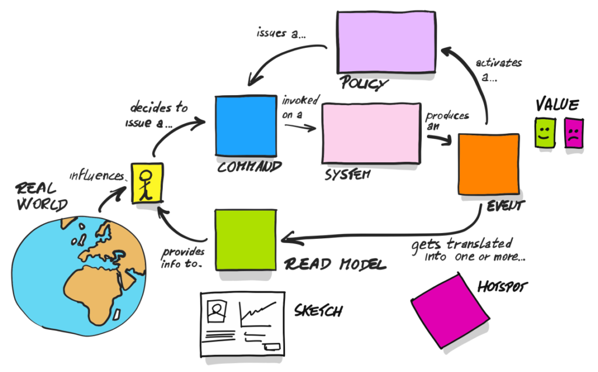
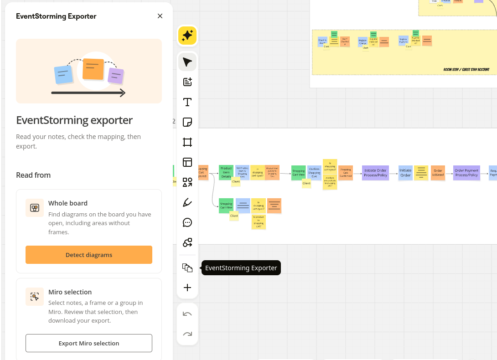
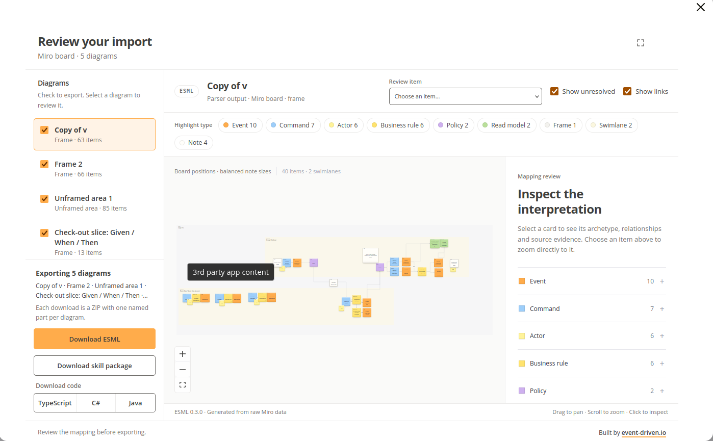

It’s interesting how things change; for many years, Alberto Brandolini said the best way to do remote EventStorming is to buy a plane ticket. But then COVID happened; now the advent of LLMs has happened. First, we were thinking about how to avoid face-to-face collaboration in favour of remote; now, we’re trying to avoid collaboration with fellow humans entirely. No, I don’t count chatting with GPT as collaboration. It’s more like sitting inside our own heads.

If we’re just sitting inside our own heads, then even if we’re super smart, we can end up with the [local maximum](https://en.wikipedia.org/wiki/Maximum_and_minimum) at best. Diversity of thoughts, experiences and perspectives, and crunching them, then getting a feedback loop this is what makes the best range of solutions. I wrote about that, e.g. in:

* [Vibing, Harness and OODA loop](/en/vibing_harness_and_ooda_loops/),
* [Removability over Maintainability](/en/removability_over_maintainability/),
* [A few words on communication](/en/a_few_words_on_communication/).

Collaboration techniques like EventStorming, [Example Mapping](/en/intro_to_example_mapping/), etc., focus on bringing people from different backgrounds together and getting the best of them. This doesn't always mean it’s easy; it’s not about holding hands and singing kumbaya. You can get that part with your LLM agent; it’s about controlled chaos and step-by-step consensus. [They give us tools for solving disagreements](/en/the-underestimated-power-of-hot-spots/).

Still, reluctance to collaborate doesn’t come from nowhere; it requires syncing up at the same time. They challenge our perspectives and require us to explain and talk. [It’s draining, I know](/en/agile_vs_introverts/). We need to learn how to facilitate them, how to timebox, and [how to organise them](/en/start-alone-then-together-why-software/). Plus…

Plus, there’s a big gap between the process model and the technical model. [I saw it multiple times on teams I worked with](/en/consulting/). They were able to come up with a model that looked right, but when I asked _“Cool, what’s next?”_ I saw the blank stare stating _”Isn’t that the end?”_.

Well, the model isn't the end; the model isn't a goal. The model is a tool for designing a solution that matches the specific business use-case goal. It should be the easiest way to achieve that and meet functional and non-functional requirements.

So a model like EventStorming should give us an understanding of the business process; it should also give us an overall understanding of the workflows and boundaries of our system. But then, as I wrote in:

* [How to design software architecture pragmatically](/en/how_to_design_software_architecture_pragmatically/)
* [On mashing up modelling techniques for fun and profit](/en/on-mashing-up-modelling-techniques/)

We need to look at it from other perspectives. And get closer to the technical design.

And some of that is the place we could actually offload, to some degree, to our LLM agents.

If we’re working on the existing system and designing the system extension, we could take the event model and ask it to research how it fits our current solution. We could also [brainstorm](/en/interactive_rubber_ducking_with_gen_ai/) with it about how to fit it in, or which technical choices would be best. What’s more, we could even [prototype some code](/en/prototype_underestimated_design_skill/) and see how it plays together.

EventStorming is a good input for that. It’s semantic, deterministic and repeatable. Just look on this image that explains (almost) everything.

It gives us integration archetypes:
- a command handler is a function that takes a command, runs business logic and returns an event and evaluates business rules,
- an event handler is a function that takes an event and does something about it, and that may produce another message (e.g., a command or another event),
- a read model is a state that’s built from events,
- etc.

Such clear abstractions and rules allow composition. This repeatability is more about how we think and break down our process, not about local minima or oversimplification. In other words, it gives us language to talk about business processes in a technical sense.

That repeatability is also what agents like, as they’re advanced pattern-matching solutions. If we can also show how those archetypes map to our design or code, then we can make this process declarative and focus on integration. Declarative in the sense that we tell _what_ we want to happen, not _how_. 

The issue we had before with [CASE tools](https://en.wikipedia.org/wiki/Computer-aided_software_engineering) still exists: tools like [Miro](https://miro.com) and [Excalidraw](https://excalidraw.com/) are great for collaborative whiteboarding, but they’re too abstract; they don’t know anything about commands, events, etc. For them, they’re just colourful rectangles. We know what they logically represent. That’s why integration and exporting their boards don’t give us a lot. We could export the image or their JSON and ask an LLM to parse it and feed it further, but I tried that and… it kinda worked, but never enough and ate too many tokens. So I’ve built a tool to help me do it. 

**I built a Miro plugin that lets me export a board deterministically.** Essentially, it’s spatial detection and math based on colours and rectangle locations. 

**You can try it out; it’s free: [EventStorming exporter](https://miro.com/app-install/?response_type=code&client_id=3458764688732244185&redirect_uri=%2Fapp-install%2Fconfirm%2F)**

Right now, it’s a simple tool: you can either select the part of your board or let the tool detect diagrams automatically.

It also allows you to review its findings and export boards to
- [ESML format](https://github.com/mardenneubert/ddd-meets-genai) (well, freaking YAML, I know…),
- generate the code structures based on it.

Both could be fed to your agent, e.g.
- start a conversation,
- add requirements in the prompt or Markdown and ask the agent to _”fill the gaps”_ in the generated code.
- cut some boring repetitive work,
- other crazy things.

It already helps me; it works on my boards, and it’d be great if you checked how it works on yours!

Still, it’s a first step and more of an example of what you could try on your own. The times are changing, but we shouldn’t drop collaboration; we should think more about how that tooling could help us to still work together and dig some holes and issues we had before.

I don’t think it’s best to just say, well, it was hard for me in past, so let’s drop it.

What else could we do? And what am I considering?

For instance, we could have the MCP server connected to our Miro and Claude Code/Codex that would know notation and, e.g. do Example Mapping brainstorming with us or help to moderate it with our domain expert. Or it could take transcription and distil the basic outline. Then continue from there. Such scenarios are great for [Behaviour-Driven Design](/en/behaviour_driven_design_is_not_about_tests/).

Or maybe put questions/hot spots/notes for us?

We could also add other diagrams like C4 or context maps and map it flows to our modules and boundaries.

There are a lot of ways to create good synergy between the model, design, and implementation.

We can benefit from the LLM helping us to do boring stuff, but still keep us collaborating and making decisions, so keeping the split where both sides can do what they’re good at.

**That’s also the motif and message I’ll be passing in [my upcoming workshop: Event-Driven Architecture: The Light and the Dark Side](/en/light-and-dark-side-of-eda-workshop/). There are still spots left, feel invited!**

I’d love to know your thoughts; you can comment here, or (better) [join the Discord and discuss there with me and the likes](https://discord.gg/fTpqUTMmVa).

Cheers!

Oskar

p.s. **Ukraine is still under brutal Russian invasion. A lot of Ukrainian people are hurt, without shelter and need help.** You can help in various ways, for instance, directly helping refugees, spreading awareness, putting pressure on your local government or companies. You can also support Ukraine by donating e.g. to [Red Cross](https://www.icrc.org/en/donate/ukraine), [Ukraine humanitarian organisation](https://savelife.in.ua/en/donate/) or [donate Ambulances for Ukraine](https://www.gofundme.com/f/help-to-save-the-lives-of-civilians-in-a-war-zone).
