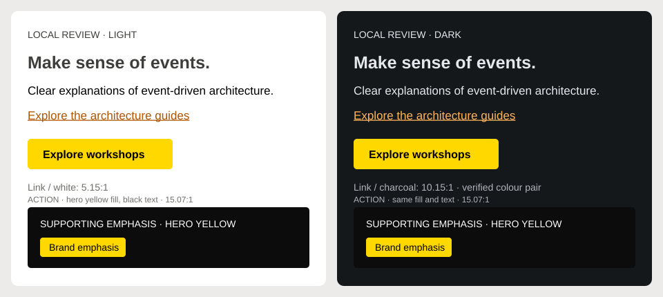

# Brand palette and accessibility

Updated 2026-10-15. This is the colour rationale and implementation reference. Start with [DESIGN.md](../DESIGN.md) for current recommendations and the change process. Verification and history belong in [todo.md](../todo.md).

## Current review direction

The owner requested applying the branding for review. The local implementation uses **warm orange for primary actions, warm yellow for emphasis, and neutral reading surfaces**. It retains the orange/yellow geometric mark, natural photography and authored hero artwork. This is implemented for review, not final visual acceptance or a deployed result.

Orange connects to events: Brandolini's [original EventStorming article](https://ziobrando.blogspot.com/2013/11/introducing-event-storming.html) explicitly assigns orange sticky notes to domain events. The article is historical, while the [current official resources](https://www.eventstorming.com/resources/) still feature his orange-stickies presentations. That supports a brand association without prescribing an exact hex code or importing diagram notation into every UI element.

The warmer orange and yellow relate to the mark's existing yellow/amber/orange faces. They replace the UI's fluorescent yellow and redder orange combination. They are exploration values chosen in relation to the artwork, not exact sampled master colours. Yellow remains available in the interface as well as imagery; it is not restricted to the logo. The owner remains open to changing either hue after seeing the combined result.

## Implemented roles

The source of truth is [tokens.css](../src/theme/tokens.css). Components own their scoped uses.

| Role                | Light     | Dark      | Use                                                                         |
| ------------------- | --------- | --------- | --------------------------------------------------------------------------- |
| Page                | `#ffffff` | `#14181b` | Neutral reading surface.                                                    |
| Alternate surface   | `#fafaf9` | `#20262c` | Cards, hover surfaces and grouped content.                                  |
| Body text           | `#000000` | `#e5e7eb` | Reading copy.                                                               |
| Muted text/icons    | `#706e6b` | `#b1b5bb` | Dates, metadata and supporting icons.                                       |
| Link/focus accent   | `#92400e` | `#ff9f43` | Readable links and focus outlines on themed surfaces.                       |
| Primary action fill | `#ff9f43` | `#ff9f43` | Hero actions, article-browse action and selected pagination.                |
| Text/icon on action | `#000000` | `#000000` | Explicit pairing with the action fill, also used by numbered guide markers. |
| Yellow emphasis     | `#ffd84d` | `#ffd84d` | Hero heading emphasis; available for coordinated brand accents.             |

The hero stays dark in either theme. Its underlined links use the warm orange action shade on that dark surface. The lead sentence is otherwise neutral; it does not colour a whole phrase merely because it contains links. The authored yellow photo shape is unchanged. Ordinary navigation remains neutral, including hover labels/icons; focus and interaction states remain visible.

Guide counts and metadata are quiet. Numbered reading steps use black on warm orange. Editorial covers, diagram notation, status colours and syntax highlighting have their own meaning and are not forced into the UI palette.

## Proportions and visual hierarchy

Use one dominant action treatment and a supporting emphasis colour. Neutral surfaces and readable text should carry the page. Judge the result by whether readers can find the main action and follow the content, not by how many elements can be made orange.

Two related brand hues plus neutrals are sufficient for this comparison. That is a project recommendation, not a universal colour-count standard. [USWDS](https://designsystem.digital.gov/design-tokens/color/overview/) distinguishes families, shades and project role tokens; [Material](https://m3.material.io/styles/color/the-color-system) assigns emphasis according to purpose. Readable shades and foreground/fill pairs do not need to be separate brand identities. Keep the existing small token system rather than adopting either framework's complete palette.

[USWDS theme guidance](https://designsystem.digital.gov/design-tokens/color/theme-tokens/) offers 60/30/10 for non-base colour families, explicitly excluding the predominant neutral base. Treat that as a heuristic, not a WCAG rule or a demand to make 60% of a reading page orange. A hero, guide overview and article naturally have different balances.

Review the homepage, guide overview, numbered guide, article with guide-step links, tag chips and search together. Include light/dark, EN/PL and mobile/desktop. A swatch or passing contrast score cannot establish visual cohesion. Preserve the shared type/spacing scale and review the [hero composition](hero-proportions-review.md) separately from colour.

## Verified colour pairs

These are local sRGB calculations, not blanket component certification. [WCAG contrast](https://www.w3.org/WAI/WCAG22/Understanding/contrast-minimum.html) requires 4.5:1 for normal text and 3:1 for qualifying large text. Test actual hover, focus, selected and composited states as well.

| Pair                                                      | Contrast | Interpretation                                  |
| --------------------------------------------------------- | -------: | ----------------------------------------------- |
| Black on warm orange `#ff9f43`                            |  10.29:1 | Action labels and reading-order numbers.        |
| White on warm orange `#ff9f43`                            |   2.04:1 | Unsuitable for normal text.                     |
| Black on warm yellow `#ffd84d`                            |  15.18:1 | Suitable if yellow is used for a labelled fill. |
| White on warm yellow `#ffd84d`                            |   1.38:1 | Unsuitable for normal text.                     |
| Deep amber `#92400e` on white                             |   7.09:1 | Underlined light-theme links.                   |
| Warm orange `#ff9f43` on dark page `#14181b`              |   8.75:1 | Dark-theme links.                               |
| Warm orange `#ff9f43` on alternate dark surface `#20262c` |   7.49:1 | Dark hover/raised-surface links.                |

Bright orange has more contrast against white than bright yellow, but neither bright candidate is suitable as small text on white. Both work well with black labels. Separating link shades from action fills preserves readability and permits the same button colour in both themes.

A fill's contrast against the page is different from its label's contrast against the fill. [WCAG non-text contrast](https://www.w3.org/WAI/WCAG22/Understanding/non-text-contrast.html) explains why a labelled button need not acquire an unwanted outline merely because its fill is below 3:1 against white. Focus and any boundary needed to identify a control still require their own checks. Do not use a low-contrast bright fill as an essential stand-alone icon on white.

## Colour vision and accessibility

Do not encode meaning through orange versus yellow alone. Preserve prose underlines, labelled controls, numbering, visible keyboard focus and programmatic selected states. This follows [WCAG Use of Color](https://www.w3.org/WAI/WCAG22/Understanding/use-of-color.html).

Review protanopia, deuteranopia, tritanopia, grayscale and forced colours. [Chromium's vision-deficiency emulation](https://developer.chrome.com/docs/chromium/cvd) is a diagnostic aid, not certification or a substitute for reader feedback. Preserve EventStorming labels/legends and authored diagram colours. Avoid global forced-colour overrides or image inversion.

## Light and dark mode

Retain light, dark and system preferences, the first-paint initializer and the reader's persistent override. Keep the current reading surfaces. Change foreground shades where the surface requires it; identical brand identity does not require identical text colours on white and charcoal.

Neither theme is universally best for every reader or situation. A [controlled proofreading study](https://pubmed.ncbi.nlm.nih.gov/25135324/) favoured dark text on a light background; it does not establish universal preference or long-term health effects. Keep both modes usable and test them independently.

## Review alternatives and next improvements

The local warm-orange/yellow version is the current review candidate. A yellow-led version with dark amber links is also viable and preserves more of the existing hero emphasis. An orange-only identity would require a deliberate review of the mark/artwork; accessibility does not demand dropping yellow. Choose between these through whole-page comparison rather than assuming one hue is scientifically correct.

Use the existing gallery for immediate review. `Hero/English`, `Hero/Polish`, `Guides/English`, `Guides/Polish` and the editorial examples share production presentation components and styles. Guide examples use controlled content; gallery previews do not certify Gatsby routing, SSR, image processing or real navigation. Keep the existing [testing responsibilities](testing-guidance.md) and review intentional screenshots before changing references.

After the palette is accepted, a sharper vector master of the existing geometric mark and a repeatable cover/social-card template are useful next steps. Preserve Open Sans and natural photography while establishing those examples. Storybook, Figma and Astro remain separate decisions under [DESIGN.md](../DESIGN.md); none is required to finish this review.
